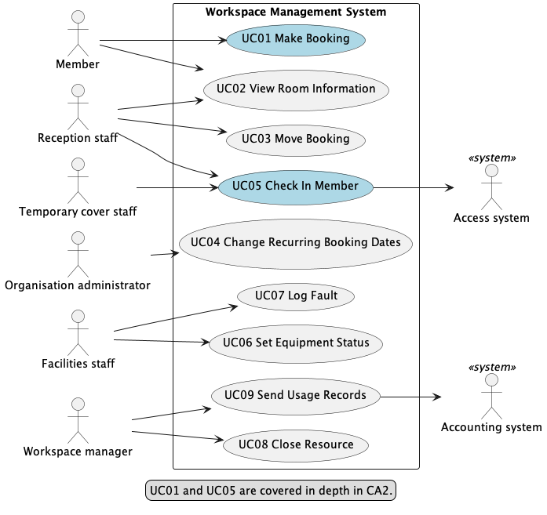

# Use-case diagram

UC01 Make Booking brings together the main booking rules: showing whether a booking is confirmed or provisional, checking that the requested equipment is available, and preventing overlapping reservations (FR09–FR11). UC05 Check In Member shows how reception and temporary cover staff record arrivals while protecting members’ commercial information (FR07, BR02), with the Access system as a supporting actor.
