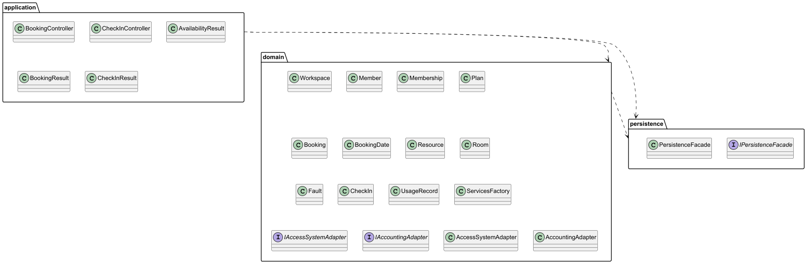

# Architecture and integration contract

## 1 Packages and layers

- **application:** the two controllers and the results they return.
- **domain:** the business classes, ServicesFactory and the adapters for outside systems.
- **persistence:** saves and loads objects. It doesn't know about any domain class.

Arrows only go down: application → domain → persistence.

## 2 Interfaces

| Interface | Operations | Used by | Provided by | Fake for testing |
|---|---|---|---|---|
| IPersistenceFacade | get(oid, type) : Object, put(oid, obj) | Workspace, BookingController, CheckInController | PersistenceFacade | FakePersistenceFacade (keeps objects in a list in memory) |
| IAccessSystemAdapter | sendArrival(checkIn) | CheckInController (after CQ13) | AccessSystemAdapter | FakeAccessSystemAdapter (remembers what was sent) |
| IAccountingAdapter | postUsage(record) | Nothing in UC01/UC05 yet (UC09, CQ09) | AccountingAdapter | FakeAccountingAdapter (keeps usage records in a list) |

Controllers get members and resources from Workspace, and Workspace loads them through IPersistenceFacade. Controllers save bookings with put. ServicesFactory gives out the real classes or the fakes for testing.

## 3 Result types

Each controller operation returns a result with success, errorCode and message. If it fails, nothing is saved.

| Operation | Returns | Works | Fails |
|---|---|---|---|
| checkAvailability | AvailabilityResult | which resources are free, and any faults | errorCode |
| makeBooking | BookingResult | booking status (Confirmed or Provisional) | errorCode, no booking made |
| checkInMember | CheckInResult | arrival time | errorCode, no check-in made |

## 4 Error conventions

| Code | When | Operation | Contract / extension |
|---|---|---|---|
| MEMBER_NOT_FOUND | Member number doesn't exist | makeBooking, checkInMember | C01, C02, UC05 2a |
| MEMBERSHIP_NOT_ACTIVE | Membership isn't active | makeBooking | C01, CQ03 |
| RESOURCE_NOT_FOUND | Resource id doesn't exist | checkAvailability, makeBooking | Sequence diagrams |
| RESOURCE_HAS_FAULT | Resource has a fault | checkAvailability | UC01 2a, CQ06 |
| ORIENTATION_REQUIRED | Resource needs orientation | checkAvailability | UC01 2b, BR04, CQ12 |
| RESOURCE_CONFLICT | Another booking overlaps | makeBooking | C01 4a, FR11 |
| EQUIPMENT_UNAVAILABLE | Room free but equipment isn't | makeBooking | C01 5a, FR10 |
| EXTENSION_CONFLICT | Extension hits a later booking | makeBooking | C01 4b, BR03 |
| NO_BOOKING_TODAY | No booking for today | checkInMember | C02, UC05 2b, CQ08 |

## 5 Persistence boundary

Storage stops at IPersistenceFacade. Nothing below it knows about domain classes.

## 6 Assumptions

- IPersistenceFacade: depends on CQ02 and CQ03.
- IAccessSystemAdapter: what gets sent is unknown (CQ13). Not used until it's answered.
- IAccountingAdapter: whether charges are worked out here is unknown (CQ09).