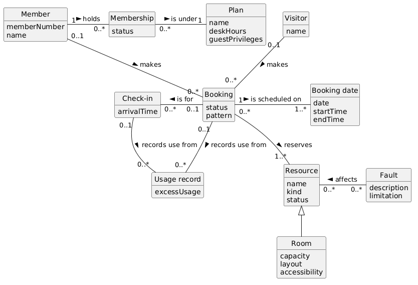

# Domain model

The model has 11 classes.

## Key decisions

**Generalisation.** Room is a kind of Resource. Only rooms have capacity, layout and accessibility (FR03). Desk and equipment are just a `kind` on Resource.

**Booking date.** Its own class, because FR12 changes or removes one date and keeps the rest of the recurring booking.

**Multiplicity.** Where the scenario didn't say, I used the loosest option.
- A member can hold 0..* memberships.
- A booking reserves 1..* resources.
- A check-in may have no booking, because people arrive without one (CQ08).
- A booking is made by a member or a visitor. CQ10 is still open.
- A fault affects 0..* resources.

**Left out.** Staff roles and the access and accounting systems are actors, not classes. Invoices belong to the accounting system. Occupancy and availability are worked out, not stored.
